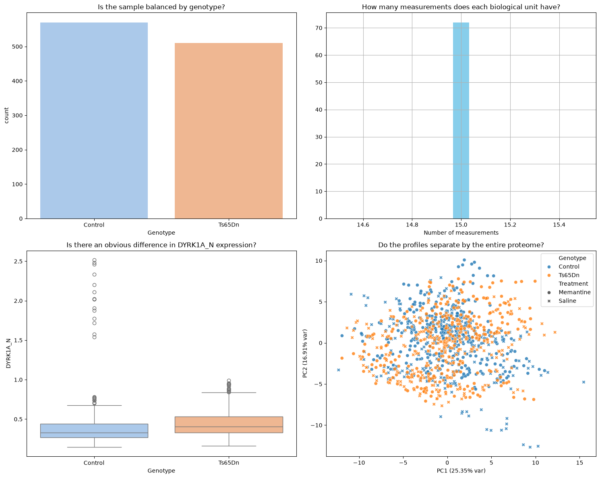
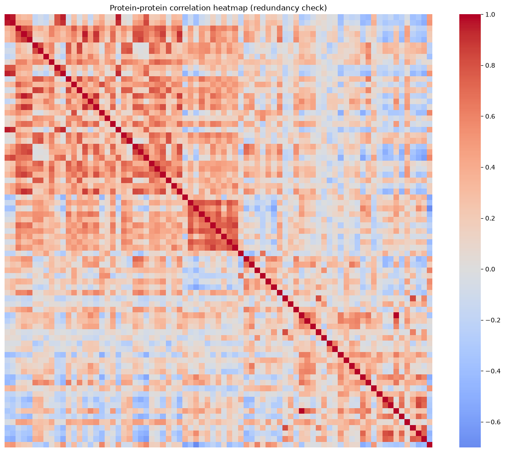
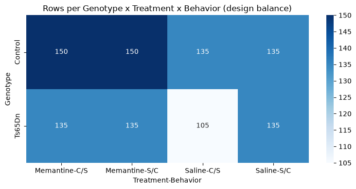

# Practical 1 report: preparing biological data for machine learning

**Student:** [Inna Kucherova]  
**Date:** [2026-10-11]  
**Practical:** 1 - Data to ML-ready format

## 1. Executive summary

The question: can the 77 cortical proteins tell apart control and trisomic (Ts65Dn) mice. Data is the UCI Mice Protein set — 1,080 rows, 72 mice (38 control, 34 trisomic), 15 measurements each (RPPA, 5 dilutions × 3 spots). Target is Genotype, features are the 77 proteins.
Prep was mostly obvious. Made a mouse_id from MouseID. Dropped class (it’s just genotype+behavior+treatment glued together, so it leaks the answer), dropped Treatment and Behavior, dropped the IDs. There are 1,396 missing cells (1.68%), so I just imputed with the median, fit on train only. Data quality is fine apart from a couple of things worth noting: some proteins are missing a lot (BCL2_N up to 26%) and one value is negative (RRP1_N), which shouldn’t happen.
Split is a 75/25 GroupShuffleSplit on mouse_id so a mouse’s 15 rows don’t get spread across train and test — otherwise the score would just be inflated. Main caveat is the obvious one: 72 mice vs 77 features, so don’t expect a tight generalization estimate.

## 2. Data-preparation readiness

## Scientific purpose and provenance

- [x] Is the biological question and prediction task stated clearly?

Y, binary clasification of genotype from 77 protein-expression features

- [x] Is the unit of observation clear (for example, patient, tissue, cell, mouse, or technical measurement)?

2-levels:
one row=one technical RPPA measurement
independent biological unit=one mouse (15 rows each)

- [x] Have I recorded the data version, processing history, and transformations already applied?

UCI id 342, DOI 10.24432/C50S3Z; values are RPPA nuclear-fraction expression levels; `mouse_id` derived by splitting `MouseID` on the final underscore

## Table shape and identifiers

- [x] Is the table tidy: one observation per row, one variable per column, and one value per cell?

Y, one measurement per row, one variable per column, one value per cell

- [x] If the original assay has features in rows and samples in columns, have I transposed it into the format expected by the analysis tool?

samples are already in rows and proteins in columns

- [x] Are row names, column names, and identifiers clear, unique, stable, and free from accidental index columns?

Y, `MouseID` is unique per row

- [x] Can every feature and observation be traced back to its source?

Y, via `MouseID` to `mouse_id`

- [x] Are the feature matrix and metadata aligned by an explicit identifier rather than by row order?

Y, aligned on `MouseID`/`mouse_id`

## Types, values, and measurement meaning

- [x] Are numerical, categorical, ordinal, text, date, and identifier columns correctly classified?

Y, 77 continuos proteins, categorical Genotype/Treatment/Behaviour/class, identifier MouseID/mouse_id

- [x] Are units, scales, encodings, reference categories, and detection limits understood?

values are RPPA expression non-negative intensities, reference genotype iss Control

- [x] Have I checked impossible values, inconsistent labels, unexpected categories, constant features, and extreme values?

Y, one negative value, no inconsistent labels, no constant features

- [x] Are normalization, scaling, log transformation, and batch-correction steps documented?

only inside PCA for EDA; no additional transform applied before splitting

## Missing values

- [x] Have I detected missing values using the dataset's actual missing-value representations, not only `NaN`?

Y, confirmed against metadata

- [x] Have I measured missingness by row, column, group, and relevant batch or time variable?

Y, 1396 cells total, 528 rows ≥1 missing, per-protein rates computed

- [x] Do I know whether missingness is structural, technical, or plausibly related to the biology or target?

technical, concentrated in a few proteins; not structurally tied to genotype

- [x] Have I justified whether to retain, remove, or impute missing values?

Y, imputation choosen

- [x] If imputing, will the imputer be fitted on training data only and then applied to validation/test data?

Y, `SimpleImputer(median)` fitted on train

## Replicates, dependence, and grouping

- [x] Have I checked for exact duplicates and near-duplicate observations?

No full duplicate rows; the 15 within-mouse repeats are expected 

- [x] Are observations biological replicates, technical replicates, repeated measurements, pseudo-replicates, or independent samples?

Technical replicates, dilution series × spots, not independent mice

- [x] Is the independent biological unit identified by a grouping variable?

Y, `mouse_id`

- [x] Will all related observations and their derivatives remain in the same train/validation/test split?

Y, GroupShuffleSplit

- [x] If I created augmented or synthetic observations, is their provenance recorded and reproducible?

N, synthetic data created

## Target, leakage, and study design

- [x] Is the target defined before modelling, with its classes or values checked for balance and validity?

Y, Genotype, 570 Control / 510 Ts65Dn rows (38/34 mice)

- [x] Have I excluded identifiers, post-outcome variables, duplicated target information, and other leakage sources from the features?

Y, MouseID, mouse_id, class

- [x] Have I identified batch, site, plate, subject, cohort, treatment, sex, age, time, or other possible confounders?

Y, Treatment, Behavior, composite class

- [x] Have I checked whether the target is associated with a technical or grouping variable?

Y, measurements-per-mouse constant; treatment/behavior approximately balanced

- [x] Does the planned split represent the biological generalization question?

Y, generalization to unseen mice

## Reproducibility and decision record

- [x] Are random seeds, software versions, file names, and input/output shapes recorded?

Y, `random_state=42`; versions printed in the notebook; split shapes documented

- [x] Are all preprocessing steps placed in a reproducible pipeline?

Y, in the notebook

- [x] Have I recorded unresolved data-quality concerns and the decisions made about them?

Y, negative RRP1_N value and high-missingness proteins

- [x] Can another person explain what each row, column, feature, target, and grouping variable means?

Y, n the column-role table (`outputs/column_roles.csv`)

### 3.1 Data presentation

Describe:
- what one row represents 
- what one biological mouse represents 
- `MouseID` and derived `mouse_id` 
- `Genotype`, `Treatment`, `Behavior`, and `class` 
- the prediction target selected.

**Answers:**  
[- **One row** = one technical RPPA measurement (one dilution point × one replicate spot) for a mouse sample.
- **One biological mouse** = 15 rows, grouped through `mouse_id`.
- **`MouseID`** (e.g. `365_14`) identifies a single measurement record; **`mouse_id`** (`365`) is the derived biological unit — everything before the final underscore.
- **`Genotype`**: Control vs Ts65Dn. **`Treatment`**: Memantine vs Saline. **`Behavior`**: C/S (context-shock) vs S/C (shock-context). **`class`**: an 8-level composite of genotype + behavior + treatment.
- **Prediction target**: `Genotype` (control vs trisomy) — the biologically cleanest question. `class` was rejected as the target because it is built from genotype by construction, so predicting it from proteins while genotype is embedded in it would conflate the question.]

Explain the structure of the dataset

**Structure of the dataset:** a hierarchical, repeated-measures design — 72 mice, each contributing 15 correlated technical measurements, described by experimental metadata (genotype, treatment, behavior) and 77 continuous protein readouts. The measurement level and the biological level must be kept distinct for a valid split

### 3.2 Tidy-data assessment and EDA

- rows and columns: 1080 × 83 (after adding `mouse_id`); 77 protein features.
- unique mice: 72 (Control 38, Ts65Dn 34).
- measurements per mouse: 15 for every mouse (min = max = 15).
- categories and counts:
  - Genotype — Control 570, Ts65Dn 510
  - Treatment — Memantine 570, Saline 510
  - Behavior — S/C 555, C/S 525
  - class — 8 levels (105–150 rows each: c-CS-m 150, c-SC-m 150, c-CS-s 135, c-SC-s 135, t-CS-m 135, t-SC-m 135, t-SC-s 135, t-CS-s 105)
- tidy: Y — one measurement per row, one variable per column, one value per cell. The only caveat is that `MouseID` mixes the measurement id with the biological unit, which is why `mouse_id` was derived.

Plots and the biological question each addresses:

1. *Countplot of Genotype* — is the target balanced? Control 570 / Ts65Dn 510 (≈53 % / 47 %), a mild imbalance, so stratification is desirable.
2. *Histogram of measurements per mouse* — is the 15-per-mouse design intact? Y — all 72 mice have exactly 15 measurements, so measurement count is not a confounder.
3. *Boxplot of DYRK1A_N by Genotype* — is there an obvious biological signal? The median is slightly higher in Ts65Dn (DYRK1A lies on the triplicated chromosome), but the distributions overlap heavily, so a single protein is a weak discriminator.
4. *PCA (PC1 25.35 % + PC2 16.91 % variance, ≈42 % together), colored by Genotype / styled by Treatment* — does the whole proteome separate the groups? Control and Ts65Dn do not separate cleanly, so genotype is encoded in subtle multivariate patterns rather than a few proteins — an argument for a multivariate ML model over a simple threshold.

### 3.3 Diagnostics

- missingness in proteins and metadata: 1,396 missing protein cells (1.68 %); 528 rows with ≥1 missing; metadata has none. Worst proteins: BCL2_N 26.4 %, H3MeK4_N 25.0 %, BAD_N 19.7 %, EGR1_N 19.4 %, H3AcK18_N 16.7 %, pCFOS_N 6.9 %.
- duplicate rows or duplicate measurement identifiers: no full-duplicate rows, `MouseID` unique
- expected 15 measurements per mouse: confirmed for all 72 mice
- unusual categories or inconsistent labels: all categories fall in the expected sets
- non-finite, negative, or implausible values: 0 infinities; 1 negative value — `RRP1_N = -0.062` at `MouseID 365_14` (likely a background-subtraction artifact, value near zero); all other values non-negative
- highly correlated or redundant proteins: 10 pairs with |r| > 0.9, notably ARC_N–pS6_N (r ≈ 1.00), DYRK1A_N–BRAF_N (0.96), DYRK1A_N–ITSN1_N (0.96), NR1_N–pNR1_N (0.95) — a cluster of collinear proteins, visible as the red block below.

- predictors that are deterministic parts of the target: `class` — each of its 8 levels maps to exactly one genotype, so it directly encodes the target and is excluded

### 3.4 Preparation and feature roles

Selected supervised-learning question: predict `Genotype` (Control vs Ts65Dn) from the 77 protein-expression features

- X = 77 protein columns; y = `Genotype`; groups = `mouse_id`.
- Excluded: `MouseID` / `mouse_id`, `class`, `Treatment` / `Behavior`

Missing-value decision: two rules were compared:
(A) A defensible removal rule — drop proteins with > 5 % missing — would remove 6 proteins (BCL2_N, H3MeK4_N, BAD_N, EGR1_N, H3AcK18_N, pCFOS_N). 
(B) Median imputation keeps all 77 proteins. 

**Imputation was chosen**, overall missingness is low (1.68 %) and scattered, and dropping whole proteins would discard biological signal. The imputer is fitted on the training set only and applied to the test set to avoid leakage

### 3.5 Split strategy
- Independent biological unit: mouse (`mouse_id`)
- Grouping variable: `mouse_id`
- Split method: `GroupShuffleSplit`
test_size = 0.25, random_state = 42
rain 810 rows / 54 mice, test 270 rows / 18 mice, mouse overlap = 0

### 3.6 Confounding and distribution structure

- treatment vs genotype: at the mouse level Control = 20 Memantine / 18 Saline, Ts65Dn = 18 Memantine / 16 Saline — approximately balanced, not perfectly
- behavior vs genotype: roughly balanced; the only visible row-level imbalance is the smallest cell t-CS-s (105 rows vs 135 elsewhere)
- genotype: the target itself, 570 / 510 rows (38 / 34 mice)
- composite class: directly encodes the target (each class = one genotype) — the primary leakage source, excluded
- number of measurements per mouse: exactly 15 for every mouse, so it is not a confounder

At least one source of bias/confounding/leakage: the dominant risk is target leakage via `class`; a secondary risk is that a model could exploit the experimental-design structure (Treatment/Behavior) instead of protein biology, which is why those factors were excluded from X

## References and reproducibility
Provided together with this report:
- notebook — `Practical01_IKucherova.ipynb`
- data files — `outputs/X_train.csv`, `outputs/X_test.csv`, `outputs/y_train.csv`, `outputs/y_test.csv`, `outputs/column_roles.csv`, `outputs/missingness_report.csv`
- generated plots — `plots/03_eda_panel.png` (balance / measurements / DYRK1A_N / PCA), `plots/05_correlation_heatmap.png`, `plots/08_design_balance.png`

Reproducibility: `random_state = 42`; library versions printed in the notebook (pandas, numpy, scikit-learn, seaborn); dataset UCI id 342 (DOI 10.24432/C50S3Z)