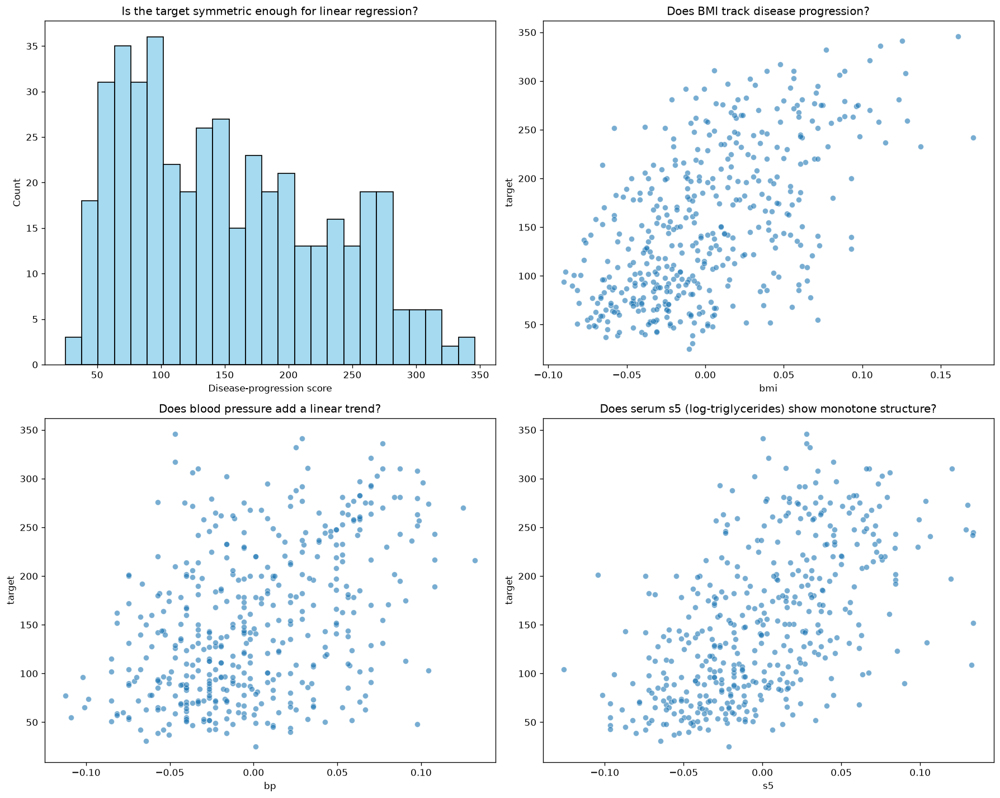
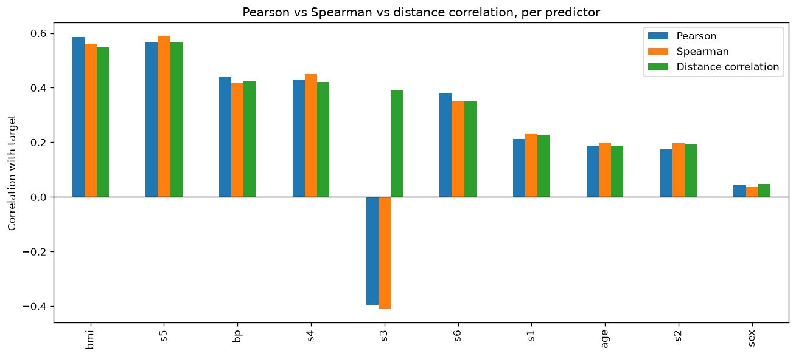
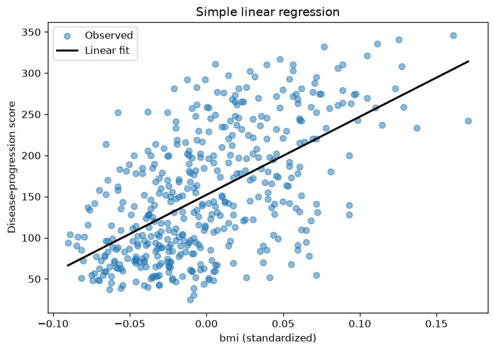
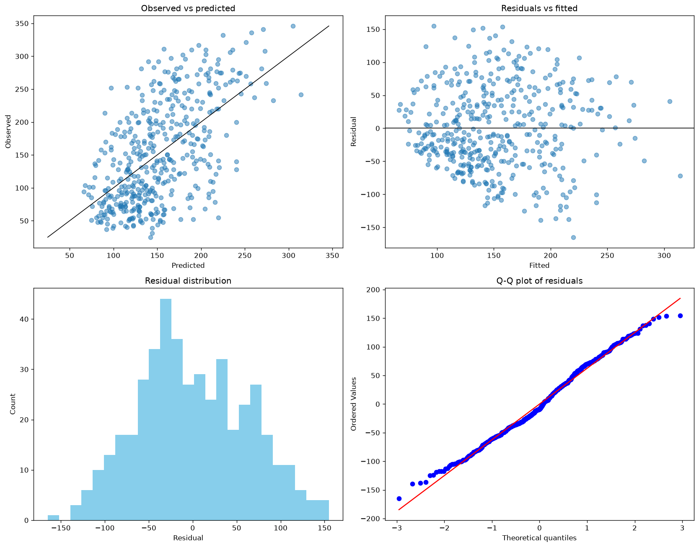
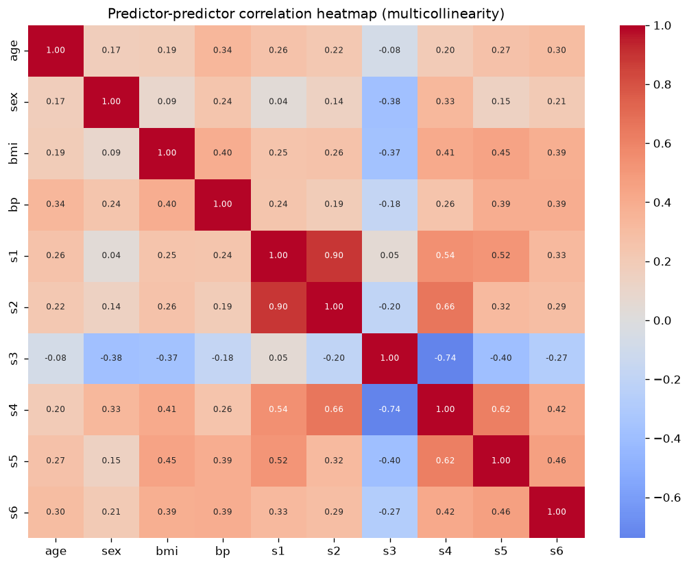

# Practical 2 report: from relationships to predictive models

**Student:** [Inna Kucherova]
**Date:** [2026-10-11]
**Practical:** 2 - Regression and evaluation

## 2. Data-preparation readiness

### Scientific purpose and provenance

- [x] Is the biological question and prediction task stated clearly?

Y — regression of a quantitative one-year disease-progression score from 10 baseline physiological features

- [x] Is the unit of observation clear?

Y — one row = one patient at baseline; the patient is also the independent unit (each patient appears exactly once)

- [x] Do I know where the data came from, how they were generated, and under which access conditions they may be used?

Y — scikit-learn `load_diabetes`, from Efron, Hastie, Johnstone & Tibshirani (2004), "Least Angle Regression", *Annals of Statistics* 32(2):407–499; open, distributed with scikit-learn

- [x] Have I recorded the data version, processing history, and transformations already applied?

Y — scikit-learn 1.9.1; the 10 predictors were mean-centered and scaled to unit L2 norm by the dataset authors; no further transform applied before splitting

### Table shape and identifiers

- [x] Is the table tidy: one observation per row, one variable per column, and one value per cell?

Y — 442 × 11, one patient per row

- [x] If needed, have I transposed the original assay into the format expected by the analysis tool?

samples already in rows, features in columns

- [x] Are row names, column names, and identifiers clear, unique, and stable?

Y — integer index + 10 named predictors + `target`; no accidental index column

- [x] Can every feature and observation be traced to its source?

Y — standard benchmark distributed with scikit-learn

- [ ] Are the feature matrix and metadata aligned by an explicit identifier rather than row order?

N/A — there is no separate metadata table; everything is one frame, aligned by construction

### Types, values, and measurement meaning

- [x] Are numerical, categorical, ordinal, text, date, and identifier columns correctly classified?

Y — all 11 columns are numeric floats; `sex` is a dichotomous variable that has also been centered/scaled, so it appears as two numeric values rather than a label

- [x] Are units, scales, encodings, reference categories, and detection limits understood?

Y — predictors are unit-less (standardized, mean ≈ 0, sum of squares = 1); the target is an integer progression index on an arbitrary scale

- [x] Have impossible values, inconsistent labels, unexpected categories, constant features, and extreme values been checked?

Y — no constant columns, no missing cells, range check done; nothing impossible for a standardized matrix

- [x] Are normalization, scaling, log transformation, and batch-correction steps documented?

Y — predictors already standardized by the authors (documented above); no additional transform

### Missing values

- [x] Have missing values been detected using all representations, not only `NaN`?

Y — no sentinel codes possible in a standardized numeric matrix; `NaN` count = 0

- [x] Have missing values been measured by row, column, and relevant group?

Y — 0 missing cells, 0 rows affected

- [x] Do I know whether missingness is structural, technical, or plausibly related to biology or the target?

no missingness present

- [x] Have retention, removal, or imputation been justified?

Y — nothing to impute or remove; all 442 × 10 kept

- [ ] If imputing, will the imputer be fitted on training data only?

no imputation needed

### Replicates, dependence, and grouping

- [x] Have exact and near-duplicate observations been checked?

Y — 0 exact duplicate rows

- [x] Are observations biological replicates, technical replicates, repeated measurements, pseudo-replicates, or independent samples?

Independent samples — one patient per row, no repeated measures

- [x] Is the independent biological unit identified by a grouping variable?

The patient is the unit; no grouping variable is needed because each patient appears once

- [x] Will related observations remain in the same train/validation/test split?

Y — no related observations exist, so a plain random split keeps independence

- [x] Is the provenance of synthetic or augmented observations recorded?

N — no synthetic or augmented data created

### Target, leakage, confounding, and reproducibility

- [x] Is the target defined before modelling?

Y — `target` = one-year disease-progression score; continuous, range 25–346, mean 152.1, no invalid values

- [x] Have identifiers, post-outcome variables, duplicated target information, and other leakage sources been excluded?

Y — the 10 predictors are all measured at baseline (pre-outcome); there is no identifier or post-outcome column

- [x] Have batch, site, subject, treatment, sex, age, time, and other possible confounders been considered?

Y — `age` and `sex` are included as predictors; there is no site/batch/treatment variable in the dataset, which is itself a limitation

- [x] Does the planned split represent the biological generalization question?

Y — a random split estimates generalization to new patients drawn from the same population

- [x] Are random seeds, software versions, file names, shapes, and preprocessing decisions recorded?

Y — `random_state = 42`; versions printed in the notebook; split shapes documented; predictors pre-standardized (no fitted preprocessing)

**Preparation summary:**

- Biological unit: one diabetes patient at baseline (442 patients)
- Number of observations and features: 442 observations, 10 predictors, 1 target
- Target and feature definition: target = quantitative disease-progression score one year after baseline; features = age, sex, BMI, mean arterial blood pressure (bp) and six blood-serum measurements (s1–s6), all mean-centered and L2-scaled
- Missing-value decision: none present (0 cells); no imputation or removal
- Replicate/grouping decision: independent patients, one row each; a plain random split is valid (no grouping variable needed)
- Main confounder or leakage source: no identifier or post-outcome leakage; the real limitation is unmeasured confounding (lifestyle, treatment, site) absent from the dataset
- Train/test split and justification: random 80/20 split, `random_state = 42`, representing generalization to new patients from the same cohort
- Remaining concerns: predictors are already standardized, so coefficients are per standardized unit (not per physical unit); strong multicollinearity among the serum predictors (VIF s1 ≈ 59, s2 ≈ 39); modest sample size (442) for 10 predictors plus diagnostics

## 3 Your task: Diabetes regression

### 3.1 Data presentation

Identify:

- **one observation** — one diabetes patient's baseline record (one row)
- **the target variable** — `target`, a quantitative disease-progression score one year after baseline (continuous, 25–346, mean 152.1, sd 77.1)
- **predictor variables** — 10 baseline measurements: `age`, `sex`, `bmi`, `bp` (mean arterial blood pressure), and `s1`–`s6` (six blood-serum measurements)
- **dimensionality of the dataset** — 442 observations × 10 predictors (+1 target)
- **whether the predictors and target have physical units or transformed scales** — the predictors have no physical units: each was mean-centered and divided by (n × its standard deviation), giving mean ≈ 0 and sum of squares = 1. The target is an integer index on an arbitrary scale. Consequence: every regression slope below is "change in progression per one standardized unit", not per mg/dL, per year, or per kg/m².

### 3.2 Descriptive analysis

- **Summarize the target.** Continuous progression score, n = 442, mean 152.1, sd 77.1, range 25–346, median 140.5 — a broad, slightly right-skewed distribution with a soft floor near 25
- **Visualize its distribution.** Top-left panel (histogram): usable for OLS, but the skew and floor are a warning for residual normality later
- **Visualize at least three predictor-target relationships.** `bmi`, `bp`, `s5` vs target (the other three panels)
- **Biological / predictive question per plot:**
  1. *Histogram of target* — is the outcome symmetric/continuous enough for linear regression?
  2. *bmi vs target* — does body-mass index, the strongest a-priori driver, track progression? (clear positive trend, heavy scatter)
  3. *bp vs target* — does mean arterial blood pressure add a visible linear trend? (weaker, still positive)
  4. *s5 vs target* — does this serum measure (log-triglycerides) show the monotone structure that later justifies a large coefficient? (positive, nearly as strong as BMI)

None of the single predictors is a tight line, so one predictor alone will leave most variance unexplained.

### 3.3 Correlation

- **Correlation using at least 2 different methods.** Three were computed — **Pearson** (linear), **Spearman** (monotone, rank-based) and **distance correlation** (any dependence):

| predictor | Pearson | Spearman | dCor |
|---|---|---|---|
| bmi | 0.586 | 0.561 | 0.548 |
| s5 | 0.566 | 0.589 | 0.565 |
| bp | 0.441 | 0.416 | 0.424 |
| s4 | 0.430 | 0.449 | 0.422 |
| s3 | −0.395 | −0.410 | 0.390 |
| s6 | 0.382 | 0.351 | 0.350 |
| s1 | 0.212 | 0.232 | 0.227 |
| age | 0.188 | 0.198 | 0.187 |
| s2 | 0.174 | 0.196 | 0.193 |
| sex | 0.043 | 0.037 | 0.048 |

- **Predictor most strongly correlated with the target.** `bmi` (Pearson 0.586), with `s5` essentially tied (0.566).
- **Compare results.** The three measures rank the predictors almost identically and give close values, so the associations are monotone *and* close to linear; distance correlation reveals no hidden non-linear predictor that Pearson missed.
- **Why correlation is not sufficient for feature selection or causal interpretation.** It is marginal and pairwise, so it cannot see that several serum measures carry the *same* information (the multicollinearity in 4.6); it says nothing about causal direction (BMI correlating with progression does not mean changing BMI changes progression, because of unmeasured confounders); and a near-zero correlation such as `sex` does not prove irrelevance, since a variable can matter only in combination with others.

### 4.4 Simple regression

Chosen predictor: `bmi` (strongest). Model `ŷ = β₀ + β₁·bmi`.

- **intercept** — β₀ = 152.13: the predicted progression at the mean BMI (bmi = 0 because it is centered); close to the overall target mean, as expected.
- **slope** — β₁ = 949.44: one standardized unit of BMI is associated with ~949 extra progression points.
- **the scale of the predictor** — standardized / unit-less (mean 0, sum of squares 1), so the slope is large in raw value and is *not* a rate "per kg/m²".
- **whether the slope is a causal effect** — No. It is an observational association that ignores the other nine predictors and any confounders, so it cannot be read causally.

### 4.5 Residual diagnostics

The four required plots are produced (observed vs predicted, residuals vs fitted, residual histogram, Q-Q).

- **Linearity** — residuals-vs-fitted is centered on zero with no strong curve, so a straight line is a reasonable first approximation for `bmi`.
- **Homoscedasticity** — spread is fairly constant, perhaps mildly wider at high fitted values; no dramatic funnel.
- **Residual normality** — the histogram is broad and the Q-Q plot follows the line in the middle but deviates at both tails: slightly heavy-tailed residuals, which weakens classical inference (p-values / CIs) more than point prediction.
- **Unusual observations** — a few large positive residuals (patients whose progression is far higher than BMI predicts).
- **Limitations of the diagnostics** — they are computed on the fitting data, so they describe *fit*, not *generalization*; and with one predictor most "misfit" is simply variance the other predictors would explain, not evidence of a wrong functional form.

### 4.6 Multiple regression and multicollinearity

Model fitted on all 10 predictors. Intercept = 152.13. Coefficients (largest |·| first): `s1` −792, `s5` +751, `bmi` +520, `s2` +477, `bp` +324, `sex` −240, `s4` +177, `s3` +101, `s6` +68, `age` −10.

- **coefficients** — `bmi` and `s5` stay strongly positive (consistent with the correlations), but `s1` is large and *negative* while `s2`/`s5` are large and positive — the classic fingerprint of collinearity among related blood-lipid measures.
- **predictor correlations** — the serum measures `s1`–`s6` are strongly intercorrelated (heatmap); `s1`/`s2` in particular are nearly collinear (|r| ≈ 0.9).
- **possible multicollinearity (VIF)** — `s1` = 59.2, `s2` = 39.2, `s3` = 15.4, `s5` = 10.1, `s4` = 8.9, all above the usual 5–10 rule of thumb, while `bmi`, `bp`, `sex`, `age` sit near 1.2–1.5. So the serum coefficients are unstable and must not be interpreted individually, even though the model's *predictions* remain fine.
- **whether standardized predictors change coefficient interpretation** — they are already standardized, so coefficient magnitudes are directly comparable as "effect per standardized unit" (convenient for ranking importance), but this still does not make them causal or stable under collinearity.

### 4.7 Train/test evaluation

Justified split: random 80/20, `random_state = 42` — valid because patients are independent, so no grouped split is needed. Simple vs multiple on the **same held-out test set**:

| model | split | MAE | MSE | RMSE | R² |
|---|---|---|---|---|---|
| Simple (bmi) | train | 51.38 | 3854.1 | 62.08 | 0.366 |
| Simple (bmi) | test | 52.26 | 4061.8 | 63.73 | 0.233 |
| Multiple (all 10) | train | 43.48 | 2868.6 | 53.56 | 0.528 |
| Multiple (all 10) | test | 42.79 | 2900.2 | 53.85 | 0.453 |

On test data the multiple model wins on every metric (RMSE 53.85 vs 63.73, R² 0.453 vs 0.233).

**Does the split answer the intended generalization question?** Yes, with a caveat. A random split estimates prediction for new patients drawn from the *same* cohort. It does **not** test generalization to a different hospital, era, or population, because the dataset has no site/batch variable to split on.

### 4.8 Independent-task conclusion

1. **Which model generalized better?** The multiple-regression model — lower test RMSE/MAE and higher test R² (0.45 vs 0.23). One predictor leaves most variance unexplained.
2. **Did adding more variables help?** Yes for prediction; test error dropped substantially from `bmi` alone to all ten predictors. The simple model even shows a train→test drop (0.37→0.23), while the multiple model stays more stable (0.53→0.45).
3. **Are any regression assumptions questionable?** Mildly — residuals are roughly linear and homoscedastic, but the Q-Q tails are heavier than normal, weakening classical inference. Independence holds (one row per patient).
4. **Are coefficient interpretations straightforward?** No — the serum predictors are strongly collinear (VIF `s1` ≈ 59, `s2` ≈ 39), so individual coefficients are unstable and can flip sign; they must be read as a group. And because predictors are standardized and the data observational, coefficients are associations per standardized unit, not causal effects per physical unit.
5. **One important limitation.** The dataset is small (442 patients) and fully anonymized/standardized with no site, treatment, or follow-up metadata, so unmeasured confounding cannot be excluded and the model cannot be validated for a new population or used for causal/clinical decisions — only as a descriptive/predictive exercise.

---

## References and reproducibility

Provided together with this report:
- notebook — `Practical02_IKucherova.ipynb`
- data files — `outputs/X_train.csv`, `outputs/X_test.csv`, `outputs/y_train.csv`, `outputs/y_test.csv`, `outputs/correlation_table.csv`, `outputs/coefficients_multiple.csv`, `outputs/vif.csv`, `outputs/metrics_train_test.csv`
- generated plots — `plots/01_eda_panel.png`, `plots/02_correlation_measures.png`, `plots/03_simple_regression.png`, `plots/04_residual_diagnostics.png`, `plots/05_multicollinearity_heatmap.png`

Reproducibility: `random_state = 42`; library versions printed in the notebook (pandas, numpy, scikit-learn, scipy, seaborn, dcor); dataset from scikit-learn `load_diabetes` (Efron et al., 2004, "Least Angle Regression", *Annals of Statistics* 32(2):407–499).
